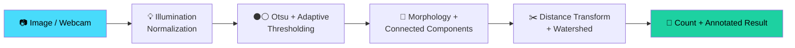

<div align="center">



<a href="https://git.io/typing-svg">
  
</a>

<br/>


</div>

---

## 🏛️ About

A small, Windows-friendly **desktop application** that counts foreground objects (tablets and capsules) in a photograph using **Python, OpenCV and traditional image processing**. Developed as the **TMI Project at the Indian Institute of Technology (IIT) Roorkee**.

It runs as a normal Python program inside VS Code or any IDE. It does **not** use Streamlit, a browser, YOLO, or any deep-learning model.

> ℹ️ The program counts objects; it does **not** classify tablets versus capsules.

---

## ✨ Features

| | Feature | Description |
|---|---|---|
| 📂 | **Image loading** | JPG, PNG, BMP or TIFF from disk |
| 📷 | **Webcam capture** | Live preview, capture a still frame |
| 🔬 | **5 result views** | Original → Grayscale → Binary → Segmented → Annotated result |
| 🧠 | **Classical CV pipeline** | Illumination normalization, Otsu + multi-scale adaptive thresholding, global & local Lab contrast, morphology, connected components, distance transform, watershed |
| 🎚️ | **Tunable detection** | Minimum contour area and touching-object split sensitivity |
| 🔢 | **Numbered detections** | Contour + bounding box per object, total count, average area, processing time |
| ⚠️ | **Segmentation warnings** | Flags large connected regions that remain unsplit |
| ✅ | **Accuracy estimate** | Enter the actual count to see overcount, undercount and count-based accuracy |
| 💾 | **Save result** | Export the annotated image |
| 🧪 | **Synthetic demo & benchmarks** | Generated 25-object demo and repeatable test cases |

---

## 🔄 Pipeline



---

## 🚀 Run from VS Code on Windows 11

1. Install **Python 3.10+** from python.org. Keep the **Python launcher** and **Tcl/Tk** options enabled (Tkinter powers the window).
2. Open the `medicine_counter` folder in VS Code.
3. Open **Terminal → New Terminal** and run:

```powershell
python -m venv .venv
.\.venv\Scripts\Activate.ps1
python -m pip install --upgrade pip
python -m pip install -r requirements.txt
python app.py
```

You can also select `app.py` and choose **Run Python File** (or press **F5**) after selecting the `.venv` interpreter.

**First run:** click **Load Synthetic Sample** for a clearly labeled, computer-generated image of 25 medicines. Use **Upload Image** for a real photograph or **Capture from Webcam** for a live frame, then click **Process Image**.

---

## 📷 Using the Webcam

Connect the camera **before** opening the app and allow desktop camera access in Windows privacy settings. The webcam button opens a live preview; choose **Capture Frame** to process the current still. This is a capture workflow, not continuous video counting.

---

## 🎚️ Tuning Detection

| Setting | What it does |
|---|---|
| **Minimum contour area** | Removes small regions. Measured in pixels after the longest image side is resized to at most 1600 px. |
| **Split sensitivity** | Controls the distance-transform marker threshold. Lower values split more aggressively but may over-segment a single irregular object. |

Check the binary and detection tabs after changing either setting. Lighting, shadows, reflections, cluttered backgrounds and heavy overlap can still cause count errors. A warning-free image is **not** a guarantee that every medicine was counted correctly.

---

## 🧪 Generate & Evaluate Sample Cases

```powershell
python sample_images\generate_samples.py
python evaluate.py
```

The generator creates 5, 10, 20 and 50 item scenes, a 25-item demo, varied colors and shapes, touching items, and bright, dim and uneven-lighting cases. Ground truth is saved in `sample_images/ground_truth.json`; evaluation results go to `sample_images/benchmark_results.csv`.

The current synthetic run counted **all 10 generated scenes exactly**, including the 25-item demo, touching objects and all three lighting variants.

> ⚠️ All generated images are synthetic drawings. These results are useful for repeatable development checks only and are **not** a real-photo accuracy guarantee. For real performance, use the app's actual-count field on representative images.

### 📐 Accuracy Calculation

Only the actual total and predicted total are known (individual objects are not matched), so:

```text
correctly counted ≈ max(0, actual − overcount − undercount)
count accuracy (%) = correctly counted / actual count × 100
```

This is a total-count estimate, not object-level precision/recall.

---

## 📁 Project Structure

```text
medicine_counter/
├── app.py                    # Tkinter desktop interface
├── detector.py               # Detection & segmentation logic
├── preprocessing.py          # Image preprocessing
├── evaluate.py               # Benchmark evaluation
├── requirements.txt
├── README.md
├── sample_images/
│   ├── generate_samples.py
│   ├── test_image.jpg
│   ├── test_image_annotated.png
│   └── (benchmark images, report, ground_truth.json)
├── utils/
│   └── visualization.py
└── assets/
    └── header.svg            # Animated README banner
```

---

## 👨‍💻 Team

<div align="center">

| 👤 Made By |
|:---:|
| **Suraj Kumar Gupta** |
| **Jatin** |
| **Harsh Pandey** |
| **Chetanya Kuchiya** |

### 🎓 Indian Institute of Technology Roorkee
**TMI Project**

</div>

---

<div align="center">


**Made with ❤️ at IIT Roorkee**

</div>
